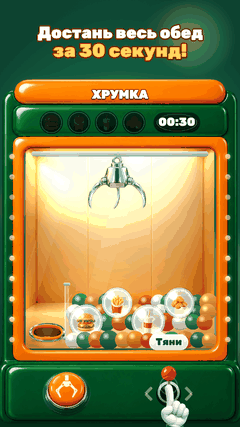
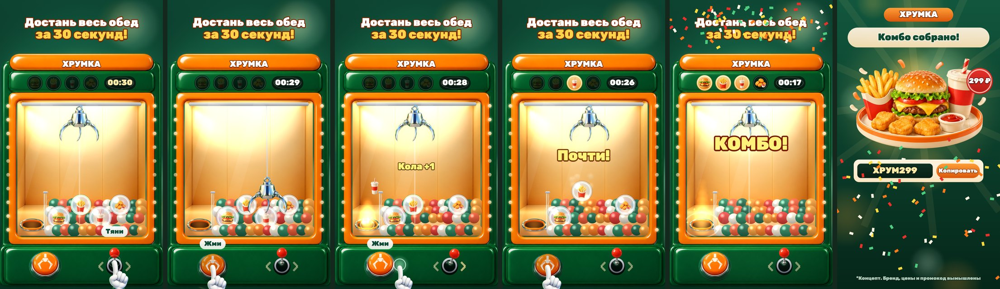
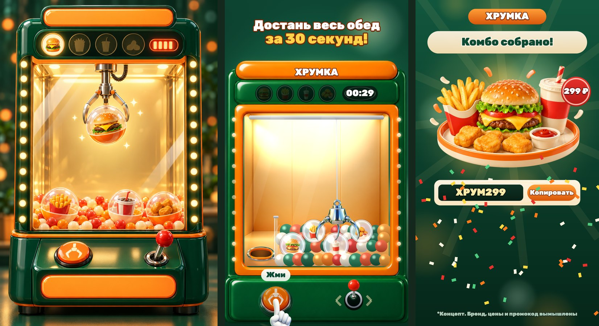

# Хрумка — автомат с обедом: playable-реклама фастфуда

**▶ Играть в браузере / с телефона:** https://bankaino.github.io/claw-machine-playable/
(A/B-вариант: [promo_win_only](https://bankaino.github.io/claw-machine-playable/promo_win_only.html))

<p align="center"><br><sub>демо-прогон, 16 с</sub></p>

Портретная 2D playable-реклама для сети быстрого питания (**концепт, бренд вымышленный**). Игрок двигает рычагом клешню автомата и за 30 секунд вытаскивает четыре капсулы — бургер, картошку фри, колу и наггетсы. Собрал все — получаешь промокод на комбо по специальной цене.

Весь пайплайн — от референса до билдов — пройден собственными скиллами для Claude Code.



От концепт-кадра до игры (слева сгенерированный концепт, дальше кадры игры):



## Как играть

1. Возьмись за красный шар рычага и потяни вбок — клешня поедет за ним (отпустил — остановилась).
2. Нажми большую оранжевую кнопку — клешня опустится, схватит капсулу и отвезёт к люку выдачи.
3. Точный захват всегда удачен, захват краем может сорваться («Почти!»). Две неудачи подряд — следующий захват краем засчитывается.
4. Таймер стартует с первого касания. Собрал четыре капсулы — комбо твоё. Не успел — промокода не будет (в варианте `promo_always` будет, см. A/B).

Управление одним пальцем: лазить по экрану не нужно, хватает перетащить рычаг, отпустить и нажать кнопку.

## Что внутри за ~15 секунд (демо-прогон)

| время | бит | что видит зритель |
|---|---|---|
| 0–1 с | хук | заголовок «Достань весь обед за 30 секунд!», бегущие лампы на рейках, рука у рычага |
| 1–3 с | первый захват | клешня опускается, капсула с бургером в лапах, искры, кольцо на кнопке |
| ~3 с | первая награда | капсула падает в люк, иконка летит в слот над стеклом, перезвон «ding», «+1» |
| ~5 с | срыв | захват краем: «Почти!» — капсула падает обратно в шарики |
| 6–14 с | цикл | ещё три захвата, каждый следующий звук выше по аккорду; на последних 10 секундах таймер краснеет, на последних 5 тикает |
| ~14 с | вау | четыре из четырёх: вспышка, конфетти, «КОМБО!» |
| ~15 с | эндкард | поднос с комбо, «299 ₽», промокод с кнопкой «Копировать», «Заказать со скидкой» (весь экран — кнопка), «Ещё раз» |

Эндкард гарантирован всем: 12 с без касаний, 10 с простоя, 30 с максимум. Постоянной кнопки CTA в игре нет, кнопка заказа живёт на эндкарде.

## A/B-варианты эндкарда

Базовое правило: **промокод даём только за победу**. Если ты ничего не сделал, просто просидел до конца по времени, или не смог собрать все четыре капсулы, код закрыт, а «Ещё раз» лежит прямо в карточке кода. Для A/B-теста есть вариант, где код выдаётся всем.

| вариант | что видит игрок без победы | гипотеза |
|---|---|---|
| `promo_always` | код всегда: «Почти! Промокод всё равно твой» после проигрыша, «Комбо за 299 ₽» с кодом тем, кто просто простоял | щедрый эндкард сохраняет клики и у проигравших, и у тех, кто не играл; считаем, сколько кликов он даёт |
| `promo_win_only` | «Не успел — попробуй ещё!» (тому, кто не касался: «Собери комбо — получи промокод!»), закрытый код, приглушённая цена, «Ещё раз» в карточке кода и крупная «Заказать» | закрытый код мотивирует доиграть и повторить; проверяем, не теряем ли клики |

Сравнивать стоит CTR эндкарда, долю повторов и долю доигравших до эндкарда. Игровая часть в обоих вариантах одинаковая, отличается только эндкард без победы.

## Баланс (прогон 300 «казуальных игроков» без браузера)

`node tools/bots.mjs 300` — боты с реакцией 0.25–0.45 с, промахами рычага ±25–60 px; часть бросает на 8 с, часть жмёт кнопку без прицела.

| метрика | значение | коридор |
|---|---|---|
| собрали все четыре | 83 % | ≥ 75 % |
| медиана времени победы | 20.2 с | 16–24 с |
| медиана неудач до победы | 2 | 1–3 |
| выиграли быстрее 12 с | 1 % | ≤ 10 % |
| первая капсула (медиана) | 1.9 с | — |

## Картинка

Корпус автомата, фон окна, еда, клешня, кнопка, рычаг, рука-подсказка и поднос — сгенерированные спрайты (ChatGPT image gen); стеклянные капсулы, шарики, бегущие лампы, блики, слоты и таймер рисуются кодом. Корпус режется на три части и растягивается по высоте, поэтому игровое окно подстраивается под любой телефон от 16:9 до 19.5:9.

## Билды под рекламные сети

```bash
python3 tools/build_playable.py --variant all
```

Каждый билд — один HTML-файл без внешних запросов (ZIP для Google): код, спрайты (WebP) и адаптер сети.

| сеть | размер | лимит | CTA / жизненный цикл |
|---|---|---|---|
| AppLovin | 0.43 MB | 5 MB | `mraid.open` |
| Unity Ads | 0.43 MB | 5 MB | `mraid.open` |
| ironSource | 0.43 MB | 5 MB | `dapi.openStoreUrl` |
| Mintegral | 0.43 MB | 5 MB | `install()`, `gameReady()`, `gameEnd()` |
| Google Ads | 0.28 MB (zip) | 5 MB | `ExitApi.exit()` |
| Meta | 0.43 MB | 2 MB | `FbPlayableAd.onCTAClick()` |

Подробности по каждому варианту — в `dist/<вариант>/report.md`. Ссылки на магазины в `tools/build.json` — заглушки, перед отправкой в сети их нужно заменить.

Посмотреть в браузере: Pages-версия по ссылке выше, либо открыть `dist/promo_always/preview.html` после сборки (`docs/` хранит собранные демо для GitHub Pages).

## Проверка

```bash
node tools/bots.mjs 300                 # баланс на ботах
node tools/smoke_test.mjs dist/promo_always/applovin.html   # телефонный прогон: загрузка, рычаг, кнопка, эндкард, CTA, fps
```

Смоук-тест открывает билд на экране телефона 390×844, играет двумя захватами, отдельно проверяет рычаг настоящим касанием (палец тянет, отпустил — рычаг отпустило), ждёт эндкард и нажимает CTA; падает при ошибках страницы, внешних запросах, fps < 50 или если CTA не вызвал `mraid.open`. Результат на последнем прогоне: 61 fps.

> Это концепт для портфолио. Бренд, цены и промокод вымышлены; логотипов и названий реальных компаний в рекламе нет.
